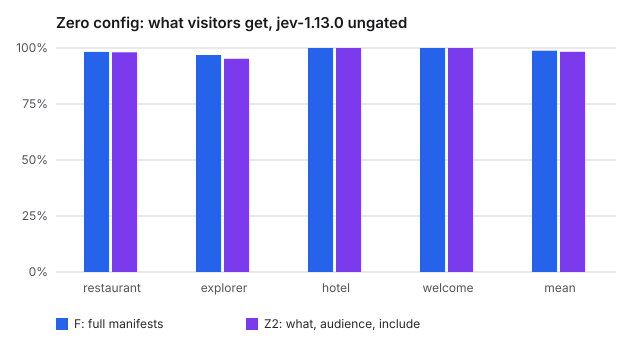

# Zero-config follow-up Z2: is what, audience and include enough?

> Registered after the [zero-config study](../zero-config/report.md) (verdict: not-shown) was known, and before Z2 was run. Reported separately; it never changes that verdict.

Generated 2026-10-13T08:11:50.837Z · engines rules, jev-1.13.0 · Jev spent this run $0.329

## Verdict

**holds-on-average.** Within 2 points of F on average, not on explorer invariants: accuracy F 98.8%, Z2 98.3%; invariants F 98.8%, Z2 97.5%.

Rule fixed before Z2 was run: Jev ungated, per site: accuracy = pooled decision accuracy, invariants = invariant pass rate. holds: on every site, Z2 accuracy and Z2 invariants are each at most 2 points below F's. holds-on-average: not holds, but Z2's accuracy and invariants averaged across the four sites are each at most 2 points below F's. not-shown: otherwise.

## Method

- **F (full):** the site's manifests unchanged.
- **Z1 (what only):** each source keeps its `what`. `not_for`, tags, `audience` and heuristics are removed, defaults become neutral (included, standard, primary, noticeable, first compatible component), and the site gets one purpose sentence.
- **Z2 (what, audience, include):** as Z1, but each source keeps its `audience` and its default `include`. `not_for`, tags and heuristics are removed; salience, region, prominence and component defaults are neutral.
- **Kept in every arm:** `mustInclude` / `mustExclude` (business rules can't be inferred) and the site's situation rules, which a developer still writes.
- **Ungated:** decisions use the engine's answers directly, with no calibration profile (provisional trust). Self-calibrated numbers, gated by a profile measured on the same fixtures, are shown beside them. The verdict uses ungated numbers only.
- **Bias:** the fixtures and labels were written against the full manifests, so F has a home advantage.

| site | purpose |
|---|---|
| restaurant | Website of Casa Lumbre, a restaurant |
| explorer | Internal dashboard for Meridian Supply's supply-chain data |
| hotel | Website of Casa Ribeira, a boutique hotel in Porto |
| welcome | Starter homepage of a new site built with web4kit |

## Casa Lumbre (restaurant)

| arm | engine | policy | relevance (raw) | all decisions | invariants |
|---|---|---|---|---|---|
| F | rules | ungated | 94.2% | 87.5% | 100.0% |
| F | rules | self-calibrated | 94.2% | 87.5% | 100.0% |
| F | jev-1.13.0 | ungated | 100.0% | 98.3% | 100.0% |
| F | jev-1.13.0 | self-calibrated | 100.0% | 95.9% | 100.0% |
| Z2 | rules | ungated | 74.1% | 82.9% | 88.2% |
| Z2 | rules | self-calibrated | 74.1% | 82.9% | 88.2% |
| Z2 | jev-1.13.0 | ungated | 100.0% | 98.1% | 99.3% |
| Z2 | jev-1.13.0 | self-calibrated | 100.0% | 99.2% | 99.6% |

Invariant failures (Z2, jev-1.13.0, ungated):

- `local-maps`: instagram present in secondary
- `regular-desktop`: hero is lunch-menu

## Meridian Supply (database explorer)

| arm | engine | policy | relevance (raw) | all decisions | invariants |
|---|---|---|---|---|---|
| F | rules | ungated | 55.9% | 55.9% | 100.0% |
| F | rules | self-calibrated | 55.9% | 55.9% | 100.0% |
| F | jev-1.13.0 | ungated | 96.3% | 96.9% | 95.7% |
| F | jev-1.13.0 | self-calibrated | 96.3% | 96.9% | 100.0% |
| Z2 | rules | ungated | 70.3% | 70.3% | 60.9% |
| Z2 | rules | self-calibrated | 70.3% | 70.3% | 60.9% |
| Z2 | jev-1.13.0 | ungated | 95.4% | 95.2% | 91.3% |
| Z2 | jev-1.13.0 | self-calibrated | 95.4% | 95.2% | 65.2% |

Invariant failures (F, jev-1.13.0, ungated):

- `analyst-spanish-question`: on-time-trend missing

Invariant failures (Z2, jev-1.13.0, ungated):

- `role=analyst,device=mobile`: on-time-trend missing
- `role=executive,device=desktop`: inventory-risk present in secondary

## Casa Ribeira (hotel starter)

| arm | engine | policy | relevance (raw) | all decisions | invariants |
|---|---|---|---|---|---|
| F | rules | ungated | 100.0% | 100.0% | 100.0% |
| F | rules | self-calibrated | 100.0% | 100.0% | 100.0% |
| F | jev-1.13.0 | ungated | 100.0% | 100.0% | 99.4% |
| F | jev-1.13.0 | self-calibrated | 100.0% | 99.6% | 100.0% |
| Z2 | rules | ungated | 86.3% | 83.4% | 97.7% |
| Z2 | rules | self-calibrated | 86.3% | 83.4% | 97.7% |
| Z2 | jev-1.13.0 | ungated | 100.0% | 100.0% | 99.4% |
| Z2 | jev-1.13.0 | self-calibrated | 100.0% | 100.0% | 98.8% |

Invariant failures (F, jev-1.13.0, ungated):

- `in-house-morning`: hero is breakfast

Invariant failures (Z2, jev-1.13.0, ungated):

- `in-house-morning`: hero is breakfast

## Welcome starter

| arm | engine | policy | relevance (raw) | all decisions | invariants |
|---|---|---|---|---|---|
| F | rules | ungated | 100.0% | 100.0% | 100.0% |
| F | rules | self-calibrated | 100.0% | 100.0% | 100.0% |
| F | jev-1.13.0 | ungated | 100.0% | 100.0% | 100.0% |
| F | jev-1.13.0 | self-calibrated | 100.0% | 100.0% | 100.0% |
| Z2 | rules | ungated | 73.1% | 73.1% | 65.1% |
| Z2 | rules | self-calibrated | 73.1% | 73.1% | 65.1% |
| Z2 | jev-1.13.0 | ungated | 100.0% | 100.0% | 100.0% |
| Z2 | jev-1.13.0 | self-calibrated | 100.0% | 100.0% | 68.6% |
