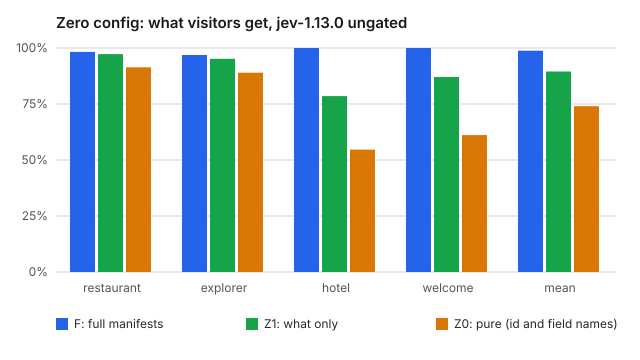

# Zero-config ablation: how much does the developer need to write?

Generated 2026-10-13T07:58:40.133Z · engines rules, jev-1.13.0 · Jev spent this run $0.599

## Verdict

**not-shown.** Neither zero-config arm passes: F 98.8%, Z1 89.5%, Z0 74.0%.

Rule fixed before any engine was run: accuracy = Jev's ungated pooled decision accuracy, averaged across the four sites. holds: Z0 accuracy >= 90%, at most 5 points below F, and Z0 invariants >= 99% on every site. holds-with-one-line: Z0 fails that test and Z1 passes it. not-shown: neither passes.

## Method

- **F (full):** the site's manifests unchanged.
- **Z1 (what only):** each source keeps its `what`. `not_for`, tags, `audience` and heuristics are removed, defaults become neutral (included, standard, primary, noticeable, first compatible component), and the site gets one purpose sentence.
- **Z0 (pure):** as Z1, but `what` is replaced by the humanised source id and its owner and system field paths. No owner-written text.
- **Kept in every arm:** `mustInclude` / `mustExclude` (business rules can't be inferred) and the site's situation rules, which a developer still writes.
- **Ungated:** decisions use the engine's answers directly, with no calibration profile (provisional trust). Self-calibrated numbers, gated by a profile measured on the same fixtures, are shown beside them. The verdict uses ungated numbers only.
- **Bias:** the fixtures and labels were written against the full manifests, so F has a home advantage.

| site | purpose |
|---|---|
| restaurant | Website of Casa Lumbre, a restaurant |
| explorer | Internal dashboard for Meridian Supply's supply-chain data |
| hotel | Website of Casa Ribeira, a boutique hotel in Porto |
| welcome | Starter homepage of a new site built with web4kit |

## Casa Lumbre (restaurant)

| arm | engine | policy | relevance (raw) | all decisions | invariants |
|---|---|---|---|---|---|
| F | rules | ungated | 94.2% | 87.5% | 100.0% |
| F | rules | self-calibrated | 94.2% | 87.5% | 100.0% |
| F | jev-1.13.0 | ungated | 100.0% | 98.3% | 100.0% |
| F | jev-1.13.0 | self-calibrated | 100.0% | 95.9% | 100.0% |
| Z1 | rules | ungated | 74.5% | 81.5% | 75.4% |
| Z1 | rules | self-calibrated | 74.5% | 81.5% | 75.4% |
| Z1 | jev-1.13.0 | ungated | 99.0% | 97.3% | 99.3% |
| Z1 | jev-1.13.0 | self-calibrated | 99.0% | 98.3% | 99.3% |
| Z0 | rules | ungated | 74.5% | 81.5% | 75.4% |
| Z0 | rules | self-calibrated | 74.5% | 81.5% | 75.4% |
| Z0 | jev-1.13.0 | ungated | 89.4% | 91.4% | 99.3% |
| Z0 | jev-1.13.0 | self-calibrated | 89.4% | 93.5% | 99.3% |

Z0 descriptions:

- `dish-photos`: Dish photos: src, alt, name, text
- `instagram`: Instagram: src, alt, url
- `dinner-menu`: Dinner menu: name, desc, price, tags, badge
- `lunch-menu`: Lunch menu: name, desc, price, tags, badge
- `hours`: Hours
- `location`: Location
- `events`: Events: title, when, detail
- `reviews`: Reviews
- `whats-new`: Whats new: title, body, image, alt

Invariant failures (Z1, jev-1.13.0, ungated):

- `local-maps`: instagram present in secondary
- `regular-desktop`: hero is lunch-menu

Invariant failures (Z0, jev-1.13.0, ungated):

- `local-maps`: instagram present in primary
- `regular-desktop`: hero is empty

## Meridian Supply (database explorer)

| arm | engine | policy | relevance (raw) | all decisions | invariants |
|---|---|---|---|---|---|
| F | rules | ungated | 55.9% | 55.9% | 100.0% |
| F | rules | self-calibrated | 55.9% | 55.9% | 100.0% |
| F | jev-1.13.0 | ungated | 96.3% | 96.9% | 95.7% |
| F | jev-1.13.0 | self-calibrated | 96.3% | 96.9% | 100.0% |
| Z1 | rules | ungated | 44.8% | 44.8% | 47.8% |
| Z1 | rules | self-calibrated | 44.8% | 44.8% | 47.8% |
| Z1 | jev-1.13.0 | ungated | 94.8% | 95.2% | 82.6% |
| Z1 | jev-1.13.0 | self-calibrated | 94.8% | 95.2% | 56.5% |
| Z0 | rules | ungated | 44.8% | 44.8% | 47.8% |
| Z0 | rules | self-calibrated | 44.8% | 44.8% | 47.8% |
| Z0 | jev-1.13.0 | ungated | 88.5% | 89.0% | 65.2% |
| Z0 | jev-1.13.0 | self-calibrated | 88.5% | 68.6% | 52.2% |

Z0 descriptions:

- `kpis`: Kpis: label, value, badge, note
- `late-shipments`: Late shipments: id, detail, eta, delay, supplier
- `supplier-status`: Supplier status: name, meta, rate, status
- `supply-network`: Supply network
- `on-time-trend`: On time trend
- `order-volume`: Order volume
- `top-products`: Top products: name, sku, revenue
- `inventory-risk`: Inventory risk: name, sku, cover, status
- `margins`: Margins: name, margin, trend
- `briefing`: Briefing: title, body

Invariant failures (F, jev-1.13.0, ungated):

- `analyst-spanish-question`: on-time-trend missing

Invariant failures (Z1, jev-1.13.0, ungated):

- `ops-manager-monday`: briefing present in footer
- `role=ops-manager,device=desktop`: briefing present in footer
- `role=ops-manager,device=mobile`: briefing present in secondary
- `role=analyst,device=mobile`: on-time-trend missing

Invariant failures (Z0, jev-1.13.0, ungated):

- `ops-manager-monday`: briefing present in footer
- `analyst-desktop`: supplier-status missing
- `executive-mobile`: hero is empty
- `role=ops-manager,device=desktop`: briefing present in secondary
- `role=analyst,device=desktop`: supplier-status missing
- `role=analyst,device=mobile`: on-time-trend missing
- `role=analyst,device=mobile`: supplier-status missing
- `role=executive,device=mobile`: hero is empty

## Casa Ribeira (hotel starter)

| arm | engine | policy | relevance (raw) | all decisions | invariants |
|---|---|---|---|---|---|
| F | rules | ungated | 100.0% | 100.0% | 100.0% |
| F | rules | self-calibrated | 100.0% | 100.0% | 100.0% |
| F | jev-1.13.0 | ungated | 100.0% | 100.0% | 99.4% |
| F | jev-1.13.0 | self-calibrated | 100.0% | 99.6% | 100.0% |
| Z1 | rules | ungated | 27.5% | 32.6% | 40.4% |
| Z1 | rules | self-calibrated | 27.5% | 32.6% | 40.4% |
| Z1 | jev-1.13.0 | ungated | 73.7% | 78.5% | 92.4% |
| Z1 | jev-1.13.0 | self-calibrated | 73.7% | 57.1% | 90.1% |
| Z0 | rules | ungated | 27.5% | 32.6% | 40.4% |
| Z0 | rules | self-calibrated | 27.5% | 32.6% | 40.4% |
| Z0 | jev-1.13.0 | ungated | 46.3% | 54.7% | 87.1% |
| Z0 | jev-1.13.0 | self-calibrated | 46.3% | 38.9% | 40.4% |

Z0 descriptions:

- `hero-photos`: Hero photos: src, alt, title, text
- `rooms`: Rooms: name, desc, price, img, alt, tags, badge
- `offer`: Offer: title, body, img, alt, badge
- `reviews`: Reviews
- `arrival-guide`: Arrival guide: title, when, detail
- `check-in`: Check in
- `getting-here`: Getting here
- `today`: Today: title, body, badge
- `breakfast`: Breakfast: name, desc, tags
- `events`: Events: title, when, detail

Invariant failures (F, jev-1.13.0, ungated):

- `in-house-morning`: hero is breakfast

Invariant failures (Z1, jev-1.13.0, ungated):

- `comparing-booking`: breakfast present in secondary
- `arriving-today`: reviews present in secondary
- `in-house-morning`: hero is breakfast
- `in-house-morning`: offer present in secondary
- `stay=left,day=fri,utc=07:30,arrival=instagram,device=mobile`: breakfast present in hero
- `stay=upcoming,day=fri,utc=07:30,arrival=maps,device=mobile`: breakfast present in primary
- `stay=upcoming,day=sat,utc=07:30,arrival=maps,device=mobile`: breakfast present in primary
- `stay=upcoming,day=sun,utc=07:30,arrival=instagram,device=mobile`: breakfast present in secondary
- … 5 more

Invariant failures (Z0, jev-1.13.0, ungated):

- `dreamer-instagram`: arrival-guide present in primary
- `dreamer-instagram`: today present in secondary
- `comparing-booking`: breakfast present in secondary
- `arriving-today`: reviews present in secondary
- `in-house-morning`: hero is offer
- `in-house-morning`: offer present in hero
- `in-house-rainy-evening`: hero-photos present in primary
- `stay=left,day=fri,utc=07:30,arrival=instagram,device=mobile`: breakfast present in primary
- … 14 more

## Welcome starter

| arm | engine | policy | relevance (raw) | all decisions | invariants |
|---|---|---|---|---|---|
| F | rules | ungated | 100.0% | 100.0% | 100.0% |
| F | rules | self-calibrated | 100.0% | 100.0% | 100.0% |
| F | jev-1.13.0 | ungated | 100.0% | 100.0% | 100.0% |
| F | jev-1.13.0 | self-calibrated | 100.0% | 100.0% | 100.0% |
| Z1 | rules | ungated | 51.9% | 51.9% | 66.3% |
| Z1 | rules | self-calibrated | 51.9% | 51.9% | 66.3% |
| Z1 | jev-1.13.0 | ungated | 88.9% | 87.0% | 98.8% |
| Z1 | jev-1.13.0 | self-calibrated | 88.9% | 90.7% | 67.4% |
| Z0 | rules | ungated | 51.9% | 51.9% | 66.3% |
| Z0 | rules | self-calibrated | 51.9% | 51.9% | 66.3% |
| Z0 | jev-1.13.0 | ungated | 62.0% | 61.1% | 67.4% |
| Z0 | jev-1.13.0 | self-calibrated | 62.0% | 88.0% | 65.1% |

Z0 descriptions:

- `welcome`: Welcome: title, body
- `get-started`: Get started: title, step, detail
- `your-situation`: Your situation: bucket, label
- `from-social`: From social: title, body
- `on-mobile`: On mobile: title, body
- `late-night`: Late night: title, body

Invariant failures (Z1, jev-1.13.0, ungated):

- `from-instagram`: on-mobile missing

Invariant failures (Z0, jev-1.13.0, ungated):

- `first-visit`: get-started missing
- `from-instagram`: from-social missing
- `from-instagram`: get-started missing
- `night-owl`: late-night missing
- `night-owl`: get-started missing
- `arrival=instagram,device=mobile,time=morning`: get-started missing
- `arrival=instagram,device=mobile,time=afternoon`: get-started missing
- `arrival=instagram,device=mobile,time=evening`: get-started missing
- … 20 more
